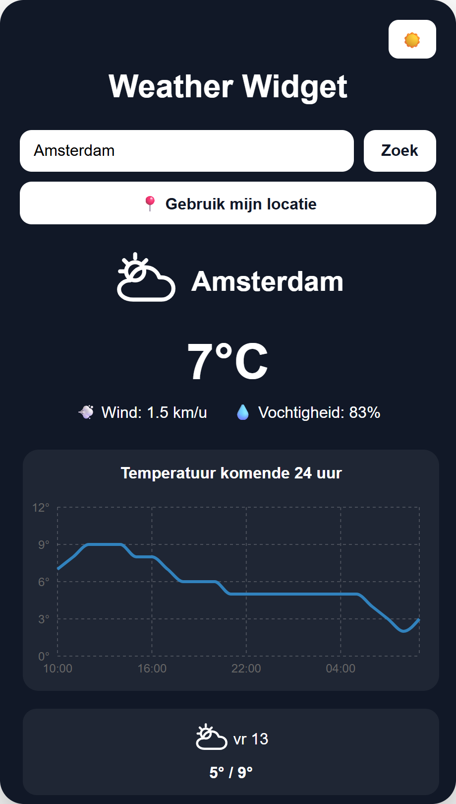
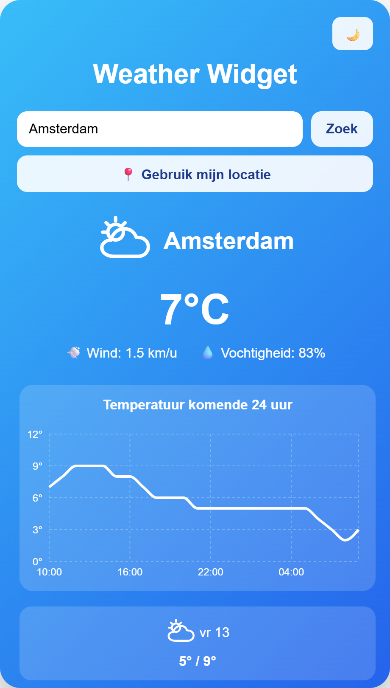
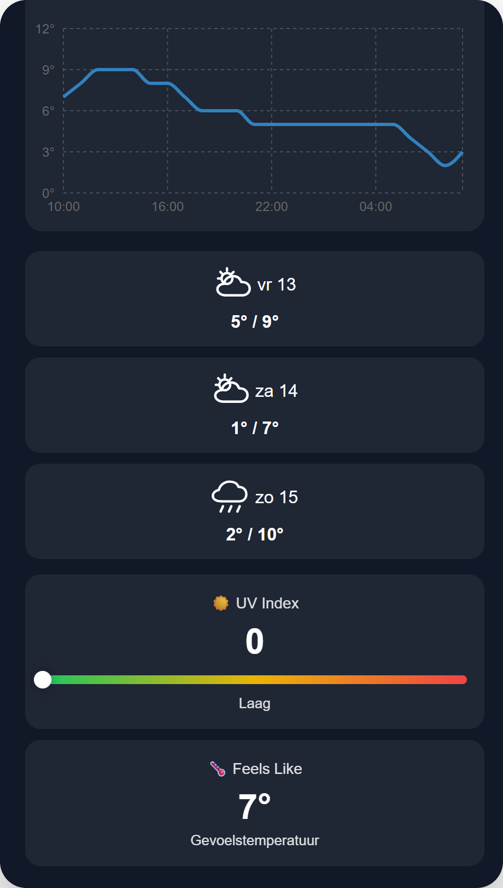
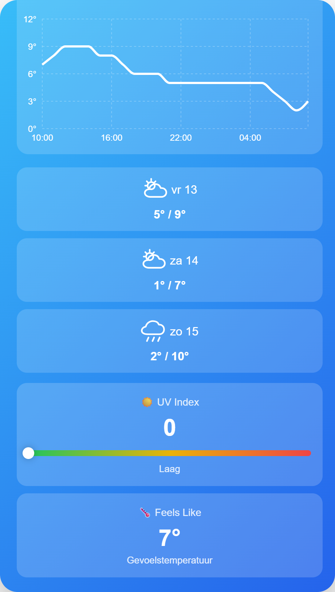

Weather Widget

Dit project is een Weather Widget die ik heb gemaakt met React en Vite. De widget haalt actuele weergegevens op via de Tomorrow.io API.

De gebruiker kan een plaats opzoeken of zijn huidige locatie gebruiken. Naast het huidige weer laat de applicatie ook een grafiek voor de komende 24 uur en een voorspelling voor de komende dagen zien.

Screenshots

| Dark mode | Light mode |
|-----------|------------|
|  |  |
|  |  |

Functionaliteiten

De Weather Widget bevat onder andere:

Zoeken naar een stad
Huidige temperatuur
Gevoelstemperatuur
Luchtvochtigheid
Windsnelheid
UV-index
Temperatuurgrafiek voor de komende 24 uur
Weersverwachting voor de komende 3 dagen
Verschillende weericonen
Huidige locatie gebruiken
Dark mode en light mode
Loading animatie tijdens het ophalen van weerdata
Responsive ontwerp voor verschillende schermformaten

Gebruikte technieken
React

Ik heb React gebruikt om de applicatie op te bouwen uit componenten en om de verschillende gegevens en states bij te houden.

Met useState houd ik bijvoorbeeld de gekozen stad, weerdata, loading status en het huidige thema bij.

Met useEffect wordt nieuwe weerdata opgehaald wanneer de locatie verandert.

Vite

Vite wordt gebruikt als development omgeving voor het React-project. Ik heb hiervoor gekozen omdat het snel is en het eenvoudig is om een React-project lokaal op te starten.

Tomorrow.io API

Voor de weergegevens gebruik ik de Tomorrow.io API.

Hiermee haal ik onder andere de volgende gegevens op:

Temperatuur
Gevoelstemperatuur
Luchtvochtigheid
Windsnelheid
UV-index
Minimum- en maximumtemperatuur
Weather codes

De weather codes worden in de applicatie gebruikt om het juiste weericoon te tonen.

Recharts

Voor de temperatuurgrafiek gebruik ik Recharts.

De grafiek toont de temperatuurontwikkeling voor de komende 24 uur. Wanneer je over de grafiek beweegt, kun je de temperatuur van een specifiek tijdstip bekijken.

Project installeren

Om het project lokaal te gebruiken moet eerst de repository worden gecloned.

Daarna moeten de dependencies worden geïnstalleerd:

npm install

Tomorrow.io API-key instellen

De API-key staat vanwege veiligheid niet in deze GitHub repository.

In de repository staat wel een bestand:

.env.example

Maak in de hoofdmap van het project een nieuw bestand genaamd:
.env

Je kunt hiervoor .env.example kopiëren en de kopie hernoemen naar .env.

Maak vervolgens een API-key aan bij Tomorrow.io en zet deze in het .env bestand:

VITE_TOMORROW_API_KEY=JOUW_API_KEY

Vervang JOUW_API_KEY door je eigen Tomorrow.io API-key of vraag mij om mijn Key.

De applicatie leest deze key in met:
import.meta.env.VITE_TOMORROW_API_KEY
Project starten

Als de dependencies zijn geïnstalleerd en de .env is ingesteld, kan de applicatie worden gestart met:

npm run dev

Vite geeft vervolgens in de terminal een lokaal adres weer, meestal:

http://localhost:5173

Open dit adres in de browser om de Weather Widget te bekijken.

Projectstructuur

De belangrijkste bestanden en mappen zijn:

weather-widget/
├── public/
│   └── icons/
├── src/
│   ├── App.css
│   ├── App.jsx
│   ├── index.css
│   └── main.jsx
├── .env.example
├── .gitignore
├── README.md
├── package.json
└── vite.config.js

public/icons

Hier staan de SVG-iconen voor verschillende weersomstandigheden, zoals:

Zon
Bewolking
Zon met bewolking
Regen
Sneeuw

Op basis van de weather code van Tomorrow.io kiest de applicatie automatisch het juiste icoon.

App.jsx

App.jsx bevat de belangrijkste functionaliteit van de Weather Widget.

Hier wordt onder andere:

De API aangeroepen
De weerdata verwerkt
De zoekfunctie afgehandeld
De huidige locatie opgehaald
Dark/light mode bijgehouden
De grafiek opgebouwd
De weersverwachting weergegeven

App.css

In App.css staat de styling van de Weather Widget.

Hierin staan onder andere de styling voor:

Dark en light mode
Zoekbalk
Weerkaarten
Temperatuurgrafiek
UV-index
Loading animatie
Responsive ontwerp
API-aanpak

Wanneer de applicatie wordt geopend, wordt standaard het weer van Amsterdam opgehaald.

Wanneer een gebruiker een andere plaats zoekt, wordt de locatie aangepast. Door useEffect wordt vervolgens automatisch opnieuw een request naar Tomorrow.io uitgevoerd.

Voor de huidige locatie wordt de Geolocation API van de browser gebruikt.

De coördinaten worden vervolgens gebruikt om weerdata voor die locatie op te halen.

Dark en light mode

De gebruiker kan wisselen tussen dark en light mode.

De gekozen mode wordt bijgehouden met React state:

const [theme, setTheme] = useState("dark");

Afhankelijk van de gekozen mode krijgt de widget een dark of light class. In CSS worden vervolgens verschillende achtergronden en kleuren gebruikt.

Loading en foutafhandeling

Tijdens het ophalen van de API-data wordt een loading animatie weergegeven.

Als het ophalen van de weerdata mislukt, krijgt de gebruiker een foutmelding te zien in plaats van een lege widget.

Hierdoor blijft voor de gebruiker duidelijk wat er gebeurt.

Responsive design

De widget is gemaakt om zowel op desktop als kleinere schermen te werken.

Met CSS media queries worden onderdelen op kleinere schermen onder elkaar geplaatst. Hierdoor blijven de forecast en extra weergegevens ook op mobiele schermen leesbaar.

Bekende beperkingen

Er zijn nog een aantal punten die verbeterd zouden kunnen worden.

API-key aan de frontend

De API-key wordt via een Vite environment variable gebruikt. Hierdoor staat de key niet in GitHub, maar bij een frontend-applicatie kan een gebruikte API-key uiteindelijk wel via de browser worden gevonden.

Voor een echte productieapplicatie zou het veiliger zijn om de API-aanroepen via een eigen backend te laten lopen.

Locatiebepaling

De locatiefunctionaliteit is afhankelijk van toestemming van de gebruiker en ondersteuning van geolocation door de browser.

Als een gebruiker geen toestemming geeft, kan deze functie niet worden gebruikt.

Beperkte weericonen

De applicatie gebruikt een aantal algemene weericonen. Tomorrow.io heeft meer weather codes dan er momenteel iconen beschikbaar zijn. Sommige vergelijkbare weersomstandigheden gebruiken daarom hetzelfde icoon.

Mogelijke vervolgstappen

Als ik het project verder zou ontwikkelen, zou ik bijvoorbeeld de volgende verbeteringen kunnen toevoegen:

Meer verschillende weericonen
API-aanroepen via een backend laten lopen
Meerdaagse weersverwachting uitbreiden
Zoekgeschiedenis opslaan
Favoriete plaatsen toevoegen
Meer details zoals neerslagkans en luchtdruk
Tests toevoegen voor belangrijke functionaliteiten
Conclusie

Met dit project heb ik een interactieve Weather Widget gemaakt met React, Vite en de Tomorrow.io API.

Tijdens het project heb ik gewerkt met API-calls, React state, useEffect, geolocation, environment variables, responsive CSS en datavisualisatie met Recharts.

De widget kan actuele weerinformatie ophalen voor verschillende locaties en geeft deze informatie overzichtelijk weer in zowel dark als light mode.
